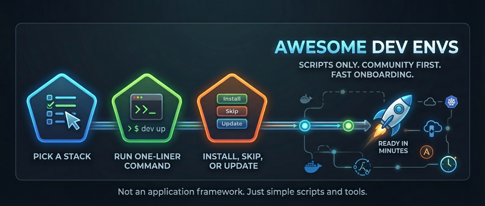

# Awesome Development Environments

Automate your setup and launch your development environment in minutes.

## What we do

We publish automated **tooling setup** to get the local environment ready in minutes.

Installers use native package managers (`apt`, `dnf`, `pacman`, `brew`, `winget`) and download fallbacks when a package is missing.

- **Scripts only:** this is not an application framework.
- **Community first:** built by developers, for developers.
- **Fast onboarding:** run one command, follow the prompts, start working.

## Usage

Pick a stack repository, run the one-liner command, then: Install, Skip, or Update each tool.  
You can also pass optional flags to the init script, check the stack repository for details.

## Overview

- Tools are declared in the `tools.yml` file of each stack.
- Profiles filter the list of tools, but it is still possible to ignore or pin individual applications.
- Prompts are translated in the available `i18n` locale files.
- Stack README files cover the remaining details, once those repositories exist.
- Unknown IDs in `--tools` cause non-interactive execution to fail (they are not silently discarded).

## How to contribute

We welcome all contributions!  
Please read our [CONTRIBUTING GUIDE](CONTRIBUTING.md) before submitting pull requests or opening issues or discussions.

## License

This is an open-source project under the [MIT LICENSE](LICENSE).

## Get in touch

- **[GitHub Discussions](https://github.com/orgs/awesome-dev-envs/discussions):** questions and ideas
- **[GitHub Issues](https://github.com/awesome-dev-envs/.github/issues):** bugs and improvements

## Important notes

- If something is wrong, missing, or a poor fit, open an issue, discussion, or a pull request. See #how-to-contribute.
- Please keep things organized in each stack repository.